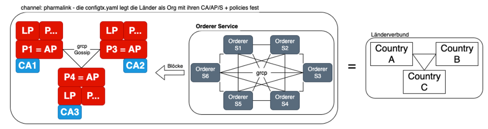
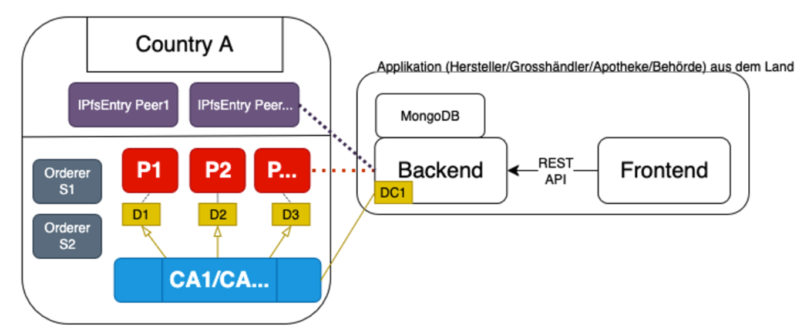
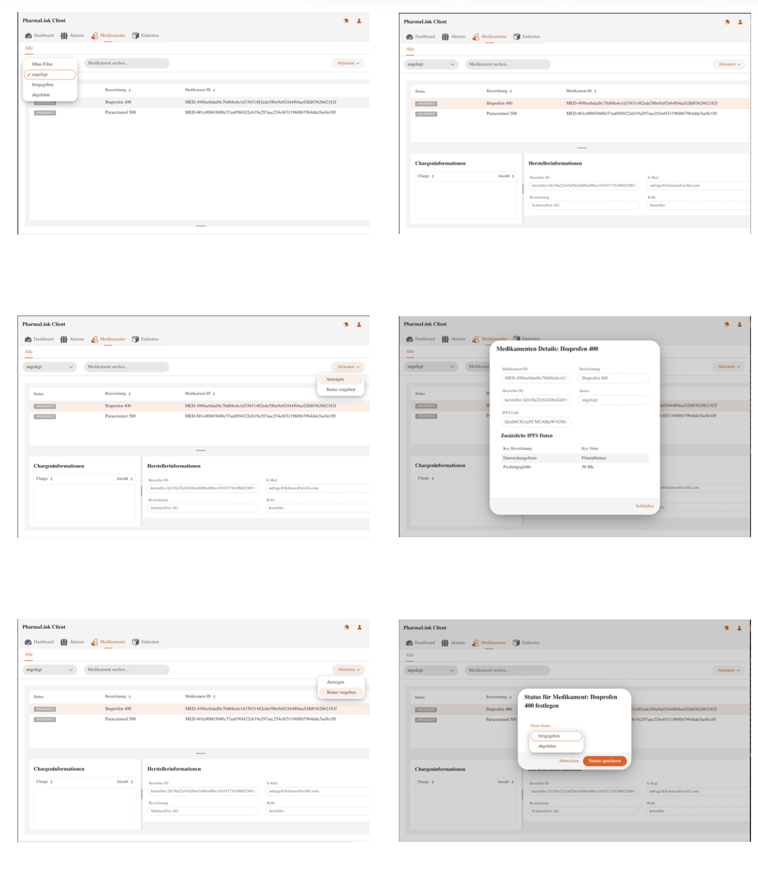
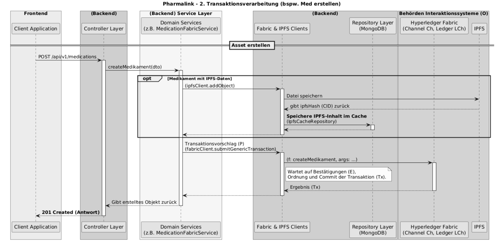
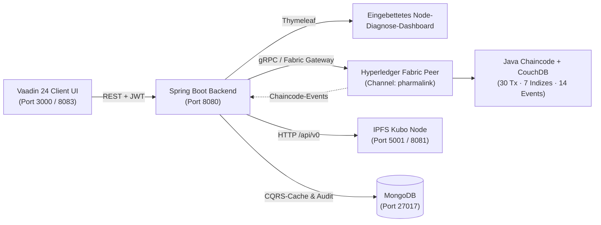

# PharmaLink

> **Permissionierte Blockchain-Testplattform auf Basis von Hyperledger Fabric 2.5, Spring Boot 3.5, IPFS, MongoDB und Vaadin 24 zur lückenlosen Rückverfolgung von Medikamenten entlang der Lieferkette (`Hersteller → Großhändler → Apotheke → Behörde`).**

**Sprache:** [English](./README.md) | **Deutsch**

[](./LICENSE)

[](https://github.com/NiklasJavier/PharmaLink/actions/workflows/ci.yml)
[](./build.gradle)
[](./build.gradle)
[](./chaincode/README.md)
[](./frontend/README.md)
[](./docker/docker-compose-pharmalink.yaml)
[](./docs/architecture.md)
[](./flake.nix)

---

> [!NOTE]
> **Projektkontext:** PharmaLink entstand als praxisnahe Demo begleitend zur Bachelorarbeit, um die Konzepte permissionierter Blockchains in der pharmazeutischen Lieferkette praktisch zu durchdringen. Das Projekt ist **abgeschlossen und wird nicht aktiv weiterentwickelt**; es bleibt als Referenz öffentlich zugänglich. Das Repository nutzt lokale Fabric-Testnetzwerk-CAs und Standard-Entwicklungszugangsdaten (siehe [`SECURITY.md`](./SECURITY.md)) — nicht unverändert produktiv einsetzen.

## Visuelle Übersicht

<table>
  <tr>
    <td align="center">
      <a href="./docs/images/1_network-overview_countries.png">
        
      </a>
      <br/><sub><b>Föderiertes Kanal-Netzwerk (<code>Länderverbund</code>)</b></sub>
    </td>
    <td align="center">
      <a href="./docs/images/2_country-architecture_local.png">
        
      </a>
      <br/><sub><b>Lokale Landesarchitektur (Peers, CA, IPFS, Backend, MongoDB, UI)</b></sub>
    </td>
  </tr>
  <tr>
    <td align="center">
      <a href="./docs/images/3_ui-medications.png">
        
      </a>
      <br/><sub><b>Vaadin 24 Client UI — Medikamentendetails, IPFS-Daten &amp; Freigabe</b></sub>
    </td>
    <td align="center">
      <a href="./docs/images/4_transaction-sequence_med-create.png">
        
      </a>
      <br/><sub><b>Transaktionsablauf — Medikament anlegen &amp; IPFS-Speicherung</b></sub>
    </td>
  </tr>
</table>

## Architektur- und Funktionshighlights

- **X.509-Zertifikat-basierte RBAC:** Jede Aufrufer-Identität leitet sich deterministisch aus MSP-ID, Client-Zertifikat und dem `role`-Attribut (`role-<sha256(mspId-clientId)>`) ab und wird direkt im Java-Chaincode über 30 `@Transaction`-Funktionen erzwungen.
- **Event-gesteuertes CQRS-Read-Model:** `SystemStateService` sichert den zuletzt verarbeiteten Block als Checkpoint in MongoDB und abonniert alle 14 Chaincode-Events per gRPC. Abfragen bleiben schnell, ohne bei jedem Read den Peer abzufragen.
- **IPFS Off-Chain-Speicher & Dual-Cache:** Erweiterte Beipackzettel-, Chargen- und Akteursdaten liegen in IPFS (`IpfsClient`), ergänzt um SHA-256-Hash-Prüfung, MongoDB-Positiv-Cache (`IpfsCacheEntry`) und einen 5-Minuten-Negativ-Cache.
- **Kühlketten- & Bereichs-Tracking:** Hersteller legen Medikamente an (`angelegt`), Behörden geben frei oder lehnen ab (`freigegeben` / `abgelehnt`), und Eigentümer erstellen nummerierte Einheiten, erfassen Temperaturmesswerte oder übertragen ganze Serienbereiche (`transferUnitRange`).
- **4-Schicht-Audit-Trail:** Eigene MongoDB-Collections protokollieren HTTP-API-Aufrufe (`ApiTransaction`), Fabric-gRPC-Transaktionen (`GrpcTransaction`), Chaincode-Events (`ChaincodeEventLog`) und Login-Versuche (`LoginAttempt`).
- **Duale Weboberflächen & OpenAPI:** Rollenbasierte Vaadin-24-Oberfläche (inkl. ZXing-QR-Codes für Akteur-IDs und Light/Dark-Theme-Wechsel), eingebettetes Thymeleaf-Diagnose-Dashboard sowie eine OpenAPI-Spezifikation mit 28 Pfaden / 31 Operationen.

## Systemarchitektur im Überblick



| Komponente | Pfad | Technologie | Verantwortung |
| :--- | :--- | :--- | :--- |
| **Backend-API & Sync** | [`./src`](./src) | Java 21, Spring Boot 3.5, Fabric Gateway, MongoDB, Thymeleaf | REST-API (`/api/v1/**`), JWT- & Form-Auth, IPFS-Cache, Block-Sync, 4-Schicht-Audit |
| **Client-Frontend** | [`./frontend`](./frontend) | Java 21, Vaadin 24.8, WebFlux, ZXing | Interaktive Web-UI (Dashboard + QR-Codes, Akteur-Explorer, Medikamente, Unit-TreeGrid) |
| **Smart Contract** | [`./chaincode/pharmalink_chaincode_main`](./chaincode/pharmalink_chaincode_main) | Java 11, Hyperledger Fabric Chaincode Shim 2.5, Genson | On-Chain-Geschäftslogik, X.509-RBAC, CouchDB-Indizes, Event-Auslösung |
| **Netzwerk & Container** | [`./scripts`](./scripts), [`./docker`](./docker), [`./common`](./common) | Bash, Docker Compose, Fabric 2.5.13, CouchDB, Kubo | Lokales Multi-Org-Fabric-Testnetzwerk, CA-Konsortium, Stack-Orchestrierung |

## Akteure & Rollen im Netzwerk

| Rolle (`role`-Attribut) | Zuständigkeit | Kernfunktionen |
| :--- | :--- | :--- |
| `hersteller` | Hersteller | Medikamente anlegen und aktualisieren, eigene Tags setzen, Einheiten freigegebener Medikamente erzeugen und übertragen |
| `behoerde` | Regulierungsbehörde | Medikamente freigeben oder ablehnen (`freigegeben` / `abgelehnt`), Prüftags setzen, Akteure und Medikamente verwalten |
| `grosshaendler` | Großhändler | Einheiten im Bestand führen, Temperaturmesswerte erfassen, Einzel- und Bereichstransfers durchführen |
| `apotheke` | Apotheke | Einheiten entgegennehmen und prüfen, Temperaturhistorie ergänzen, lückenlose Herkunft und Infoblatt-Hash nachvollziehen |

## Schnellstart (End-to-End Go-Live & Verifikation)

**1. Voraussetzungen installieren:** [Docker](https://docs.docker.com/get-docker/) + Docker Compose v2 sowie [Nix](https://nixos.org/download/) mit aktivierten Flakes (`flake.nix` liefert **JDK 21**, **JDK 11**, `just`, `shellcheck`, `jq`, `curl`, `zip`, `unzip`):

- **macOS / Linux:** `curl --proto '=https' --tlsv1.2 -sSf -L https://install.determinate.systems/nix | sh -s -- install` (offizielle Alternative: [nixos.org/download](https://nixos.org/download/))
- **Windows:** [WSL2](https://learn.microsoft.com/en-us/windows/wsl/install) + WSL2-Integration in Docker Desktop aktivieren, danach denselben Nix-Installer in der WSL2-Linux-Shell ausführen.

**2. Prüfen, starten und End-to-End verifizieren:**

```bash
# Klonen, Dev-Shell betreten und Toolchain, Builds, Skripte, Configs sowie Doku prüfen
git clone https://github.com/NiklasJavier/PharmaLink.git && cd PharmaLink
nix develop
just doctor && just check

# Hyperledger Fabric starten, Chaincode deployen, Konsortium anlegen und Container hochfahren
just up

# Live-E2E-Check: Test-Admin anmelden, Cache-/Ledger-Status abfragen, UI aufrufen
TOKEN=$(curl -fsS -X POST http://localhost:8080/api/v1/auth/login \
  -H "Content-Type: application/json" \
  -d '{"username":"admin","password":"admin123"}' | jq -r '.jwt')
curl -fsS http://localhost:8080/api/system/cache/stats -H "Authorization: Bearer $TOKEN" | jq .
# Vaadin UI: http://localhost:3000  |  Swagger: http://localhost:8080/api/swagger

# Stack sauber stoppen und erzeugte Fabric-/Wallet-/IPFS-Daten bereinigen
just down
```

Manuelles Java-11/21-Setup (`SDKMAN`), direkte Skripte ohne Nix und IDE-Workflows stehen in [docs/getting-started.md](./docs/getting-started.md).

### Standard-Endpunkte

| Dienst | Endpunkt | Hinweis |
| :--- | :--- | :--- |
| **Vaadin Client UI** | `http://localhost:3000` | Primäre Weboberfläche (`admin` / `admin123`) |
| **Backend REST-API** | `http://localhost:8080/api/v1` | JWT-geschützte REST-API (`/api/v1/auth/login` offen) |
| **Swagger UI / OpenAPI** | `http://localhost:8080/api/swagger` | Interaktive API-Doku (Schema unter `/api/api-docs` bzw. [`evaluation/openapi/openapi.json`](./evaluation/openapi/openapi.json)) |
| **Backend Diagnose-UI** | `http://localhost:8080/app/dashboard` | Eingebettetes Thymeleaf-Audit- & State-Dashboard (`admin` / `admin123`) |
| **IPFS RPC / Gateway** | `http://localhost:5001` / `http://localhost:8081` | Off-Chain-Speicher (`ipfs/kubo:v0.29.0`) |
| **MongoDB** | `mongodb://localhost:27017` | CQRS-Read-Model, IPFS-Cache & Audit-Collections (`user` / `user`) |
| **Fabric Peer / Orderer / CA** | `localhost:7051` (`Org1`), `9051` (`Org2`) / `7050` / `7054` | Lokale Fabric-Testnetzwerk-Endpunkte |

### CLI-Rolle wechseln & Umgebung zurücksetzen

```bash
# Passenden source-Befehl für eine Rolle anzeigen (hersteller, grosshaendler, apotheke, behoerde)
just role behoerde
source ./scripts/roles/fabric_role_behoerde.sh

# PharmaLink-Compose-Stack und Fabric-Testnetzwerk sauber beenden
just down   # oder: ./scripts/manage/repo_reset.sh
```

## Dokumentation

| Dokument | Inhalt |
| :--- | :--- |
| [.agents/README.md](./.agents/README.md) | Orientierungs-Hub für Agenten & Mitwirkende plus `pharmalink-navigator`-Skill |
| [justfile](./justfile) · [flake.nix](./flake.nix) | Zentrale Kommando-Oberfläche (`just --list`) und reproduzierbare Nix-DevShell |
| [docs/README.md](./docs/README.md) | Navigationsübersicht aller technischen Dokumente |
| [docs/getting-started.md](./docs/getting-started.md) | Installation, lokaler Dev-Modus, Konfigurationsvariablen, Fehlerbehebung |
| [docs/architecture.md](./docs/architecture.md) | Föderierte Netzwerktopologie, CQRS-Sync, IPFS-Caching, Sicherheit & 4-Schicht-Audit |
| [docs/domain-model.md](./docs/domain-model.md) | Datenmodell, Zustandsautomaten, RBAC-Berechtigungsmatrix, 13 Fehlercodes |
| [docs/api-reference.md](./docs/api-reference.md) | Referenz aller 28 REST-Pfade (31 Operationen) inkl. `curl`-Workflow |
| [docs/decisions/](./docs/decisions) | Architecture Decision Records (ADR-001 bis ADR-003) |
| [chaincode/README.md](./chaincode/README.md) | Smart-Contract-Spezifikation: 30 Transaktionen, 7 CouchDB-Indizes, 14 Events |
| [frontend/README.md](./frontend/README.md) | Vaadin-24-Client: Views, State-Service, QR-Code-Generierung & Theming |
| [evaluation/README.md](./evaluation/README.md) | Evaluationsartefakte (`openapi.json`, `blöcke.zip`, `organizations.zip`) |

## Projektstatus, Sicherheit & Lizenz

- **Status:** Abgeschlossene Praxis-Demo aus dem Umfeld der Bachelorarbeit ohne aktive Weiterentwicklung; Hinweise für eigene Forks und lokale Build-Checks stehen in [CONTRIBUTING.md](./CONTRIBUTING.md).
- **Sicherheit:** Abgrenzung der Test-Credentials und Härtungshinweise stehen in [SECURITY.md](./SECURITY.md).
- **Lizenz:** Veröffentlicht unter der [MIT-Lizenz](./LICENSE).
