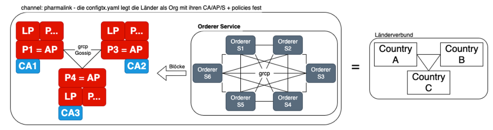
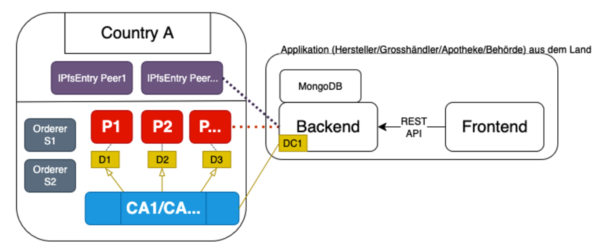
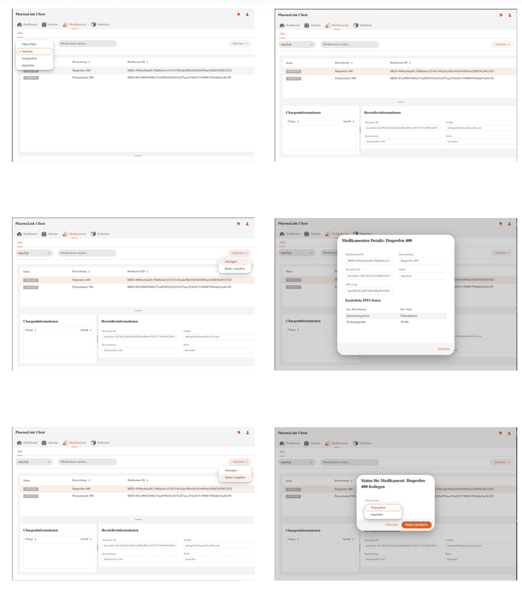
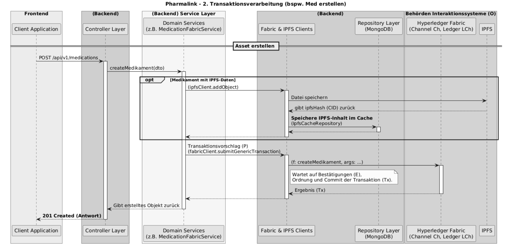
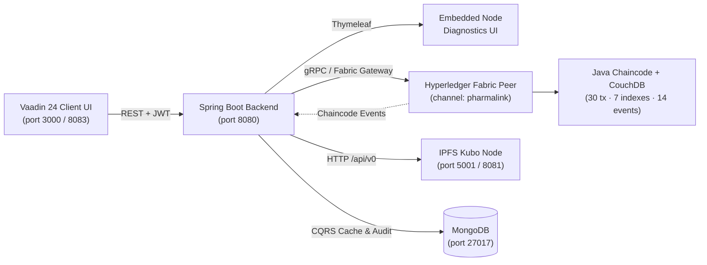

# PharmaLink

> **Permissioned blockchain proof-of-concept for end-to-end pharmaceutical supply-chain traceability (`Manufacturer → Wholesaler → Pharmacy → Authority`), built with Hyperledger Fabric 2.5, Spring Boot 3.5, IPFS, MongoDB, and Vaadin 24.**

**Language:** **English** | [Deutsch](./README.de.md)

[](./LICENSE)
[](https://github.com/NiklasJavier/PharmaLink/actions/workflows/ci.yml)
[](./build.gradle)
[](./build.gradle)
[](./chaincode/README.md)
[](./frontend/README.md)
[](./docker/docker-compose-pharmalink.yaml)
[](./docs/architecture.md)

---

> [!NOTE]
> **Project Context:** PharmaLink is an early engineering prototype built as a test and evaluation platform for federated pharmaceutical traceability. The repository uses local Hyperledger Fabric test-network CAs and default development credentials documented in [`SECURITY.md`](./SECURITY.md); do not deploy unmodified defaults to production.

## Visual Overview

<table>
  <tr>
    <td align="center">
      <a href="./docs/images/1_network-overview_countries.png">
        
      </a>
      <br/><sub><b>Federated Multi-Country Channel Network (<code>Länderverbund</code>)</b></sub>
    </td>
    <td align="center">
      <a href="./docs/images/2_country-architecture_local.png">
        
      </a>
      <br/><sub><b>Local Country Node Stack (Peers, CA, IPFS, Backend, MongoDB, UI)</b></sub>
    </td>
  </tr>
  <tr>
    <td align="center">
      <a href="./docs/images/3_ui-medications.png">
        
      </a>
      <br/><sub><b>Vaadin 24 Client UI — Medication Details, IPFS Data &amp; Approval</b></sub>
    </td>
    <td align="center">
      <a href="./docs/images/4_transaction-sequence_med-create.png">
        
      </a>
      <br/><sub><b>Transaction Sequence — Medication Creation &amp; IPFS Pinning</b></sub>
    </td>
  </tr>
</table>

## Key Engineering Highlights

- **X.509 Certificate-Driven RBAC:** Every caller identity derives deterministically from the Fabric MSP ID, client X.509 identity, and `role` certificate attribute (`role-<sha256(mspId-clientId)>`), enforced inside the Java chaincode across 30 `@Transaction` entry points.
- **Event-Driven CQRS Read-Model:** `SystemStateService` checkpoints the latest processed ledger block in MongoDB and subscribes to all 14 chaincode events over gRPC, keeping query caches synchronized without polling the peer on every read.
- **IPFS Off-Chain Storage & Dual Cache:** Extended medication leaflets, unit batch metadata, and actor profiles live in IPFS (`IpfsClient`), paired with SHA-256 leaflet hash tracking, a MongoDB positive cache (`IpfsCacheEntry`), and a 5-minute negative lookup cooldown.
- **Cold-Chain & Range Custody Tracking:** Manufacturers register medications (`angelegt`), authorities approve or reject (`freigegeben` / `abgelehnt`), and owners mint numbered batches, log timestamped temperature readings, or transfer individual units and contiguous serial ranges (`transferUnitRange`).
- **4-Layer Audit Trail:** Dedicated MongoDB collections log HTTP API calls (`ApiTransaction`), Fabric gRPC calls (`GrpcTransaction`), raw chaincode events (`ChaincodeEventLog`), and authentication attempts (`LoginAttempt`).
- **Dual Web Interfaces + OpenAPI:** Ships with a role-aware Vaadin 24 desktop/web client (including ZXing QR codes for actor IDs and a light/dark theme toggle), an embedded Thymeleaf backend diagnostics dashboard, and a 28-path / 31-operation OpenAPI specification.

## Architecture at a Glance



| Component | Path | Stack | Responsibility |
| :--- | :--- | :--- | :--- |
| **Backend API & Sync** | [`./src`](./src) | Java 21, Spring Boot 3.5, Fabric Gateway, MongoDB, Thymeleaf | REST API (`/api/v1/**`), JWT + form auth, IPFS caching, CQRS block sync, 4-layer audit trail |
| **Client Frontend** | [`./frontend`](./frontend) | Java 21, Vaadin 24.8, WebFlux, ZXing | Interactive client UI (Dashboard + QR codes, Actor Explorer, Medications, Unit TreeGrid) |
| **Smart Contract** | [`./chaincode/pharmalink_chaincode_main`](./chaincode/pharmalink_chaincode_main) | Java 11, Hyperledger Fabric Chaincode Shim 2.5, Genson | On-chain business logic, X.509 RBAC, CouchDB rich queries, event emission |
| **Network & Containers** | [`./scripts`](./scripts), [`./docker`](./docker), [`./common`](./common) | Bash, Docker Compose, Fabric 2.5.13, CouchDB, Kubo | Local multi-org Fabric test network, CA consortium provisioning, app stack orchestration |

## Supply-Chain Roles

On-chain permissions and certificate attributes use German domain identifiers mapped directly in `PharmaSupplyChainContract`:

| On-Chain Role (`role` attr) | English Equivalent | Core Permissions |
| :--- | :--- | :--- |
| `hersteller` | Manufacturer | Register medications, update own medication metadata, tag own medications, mint & transfer units for approved products |
| `behoerde` | Regulatory Authority | Approve or reject medications (`freigegeben` / `abgelehnt`), tag any medication, manually create/update/delete actors or medications |
| `grosshaendler` | Wholesaler | Hold custody of units, append cold-chain temperature readings, transfer individual units or serial ranges downstream |
| `apotheke` | Pharmacy | Receive and inspect units, append temperature logs, verify full chain of custody and leaflet hashes |

## Quickstart (Local Test Stack)

**Prerequisites:** Docker + Docker Compose v2, Java 11 & Java 21 (e.g. via [SDKMAN](https://sdkman.io/)), `curl`, `git`, `jq`, and `unzip`. See [docs/getting-started.md](./docs/getting-started.md) for OS-specific setup and IDE development workflows.

```bash
# 1. Clone the repository
git clone https://github.com/NiklasJavier/PharmaLink.git
cd PharmaLink

# 2. Load Fabric environment helpers (auto-resolves repo root)
source ./scripts/fabric_setEnv.sh

# 3. Start Hyperledger Fabric test-network (channel: pharmalink, stateDB: CouchDB)
./scripts/fabric_setup_test.sh up

# 4. Build (JDK 11) and deploy the Java chaincode
./scripts/fabric_setup_test.sh cc

# 5. Provision consortium identities (3 users per role) and run initCall
./scripts/fabric_setup_test_consortium.sh

# 6. Start Backend, Vaadin UI, IPFS, and MongoDB via Docker Compose
./scripts/pharmalink_setup.sh up
```

### Default Local Endpoints

| Service | Endpoint | Notes |
| :--- | :--- | :--- |
| **Vaadin Client UI** | `http://localhost:3000` | Primary supply-chain web UI (`LoginView`: `admin` / `admin123`) |
| **Backend REST API** | `http://localhost:8080/api/v1` | Stateless JWT-protected API (`/api/v1/auth/login` open) |
| **Swagger UI / OpenAPI** | `http://localhost:8080/api/swagger` | Interactive API docs (raw JSON at `/api/api-docs` or [`evaluation/openapi/openapi.json`](./evaluation/openapi/openapi.json)) |
| **Backend Diagnostics UI** | `http://localhost:8080/app/dashboard` | Embedded Thymeleaf audit & state viewer (`admin` / `admin123`) |
| **IPFS RPC / Gateway** | `http://localhost:5001` / `http://localhost:8081` | Off-chain document storage (`ipfs/kubo:v0.29.0`) |
| **MongoDB** | `mongodb://localhost:27017` | CQRS read-model, IPFS cache, and audit collections (`user` / `user`) |
| **Fabric Peer / Orderer / CA** | `localhost:7051` (`Org1`), `9051` (`Org2`) / `7050` / `7054` | Local Fabric test-network endpoints |

### Switching CLI Roles & Resetting

```bash
# Switch peer CLI identity without triggering initCall when sourced
source ./scripts/roles/fabric_role_behoerde.sh

# Stop the PharmaLink Compose stack and Fabric test-network cleanly
./scripts/manage/repo_reset.sh
```

## Documentation Map

| Document | Audience & Content |
| :--- | :--- |
| [docs/README.md](./docs/README.md) | Documentation index across guides, architecture, decisions, and evaluation |
| [docs/getting-started.md](./docs/getting-started.md) | Step-by-step setup, IDE local dev mode, environment variables, troubleshooting |
| [docs/architecture.md](./docs/architecture.md) | Federated network topology, CQRS sync, IPFS caching, dual security, 4-layer audit trail |
| [docs/domain-model.md](./docs/domain-model.md) | Chaincode entities, medication & unit state machines, RBAC matrix, 13 error codes |
| [docs/api-reference.md](./docs/api-reference.md) | Complete reference for all 28 REST paths (31 operations) with `curl` workflows |
| [docs/decisions/](./docs/decisions) | Architecture Decision Records (ADR-001 through ADR-003) |
| [chaincode/README.md](./chaincode/README.md) | Smart contract specification: 30 transactions, 7 CouchDB indexes, 14 events |
| [frontend/README.md](./frontend/README.md) | Vaadin 24 client UI routes, state management, QR generation, and theme setup |
| [evaluation/README.md](./evaluation/README.md) | Captured ledger block snapshots, MSP archive, and OpenAPI artifact guide |

## Contributing, Security & License

- Contributions and cleanups are welcome via [CONTRIBUTING.md](./CONTRIBUTING.md).
- For security posture and test-credential boundaries, read [SECURITY.md](./SECURITY.md).
- Released under the [MIT License](./LICENSE).
