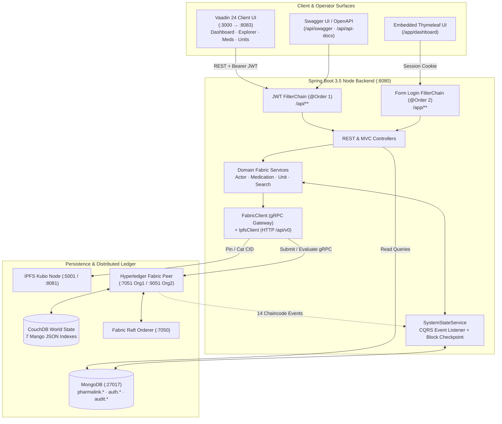
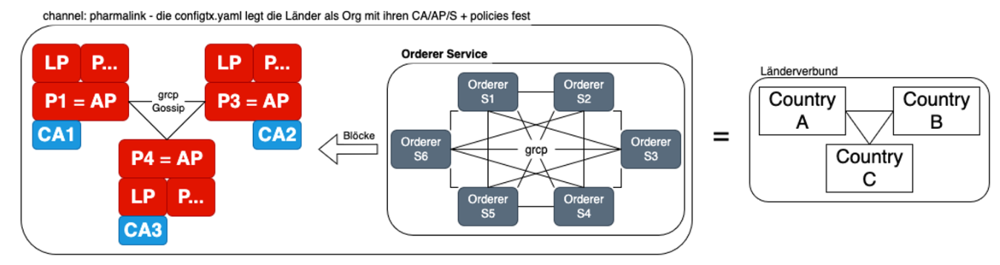
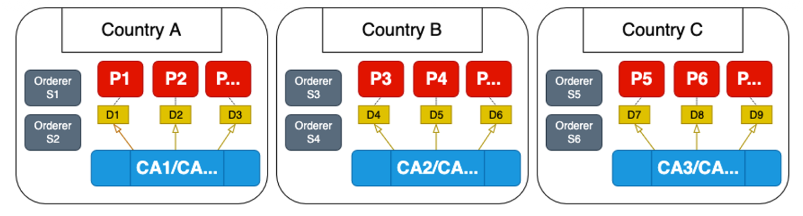
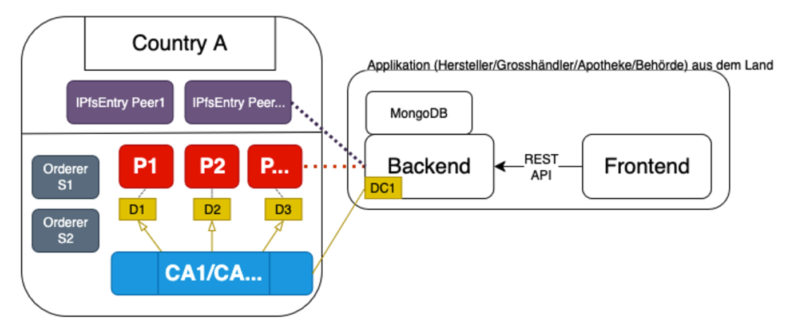
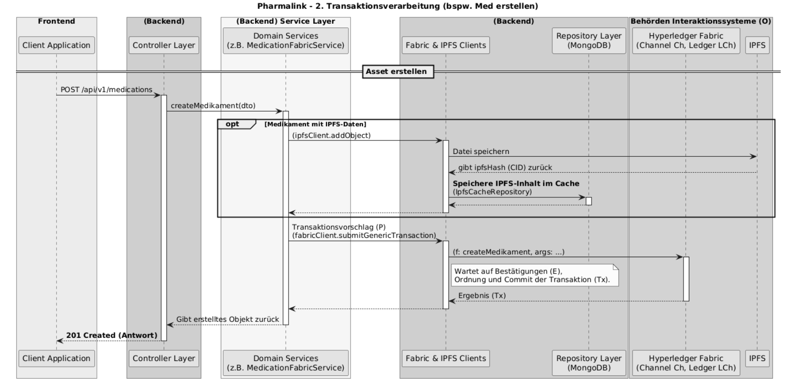
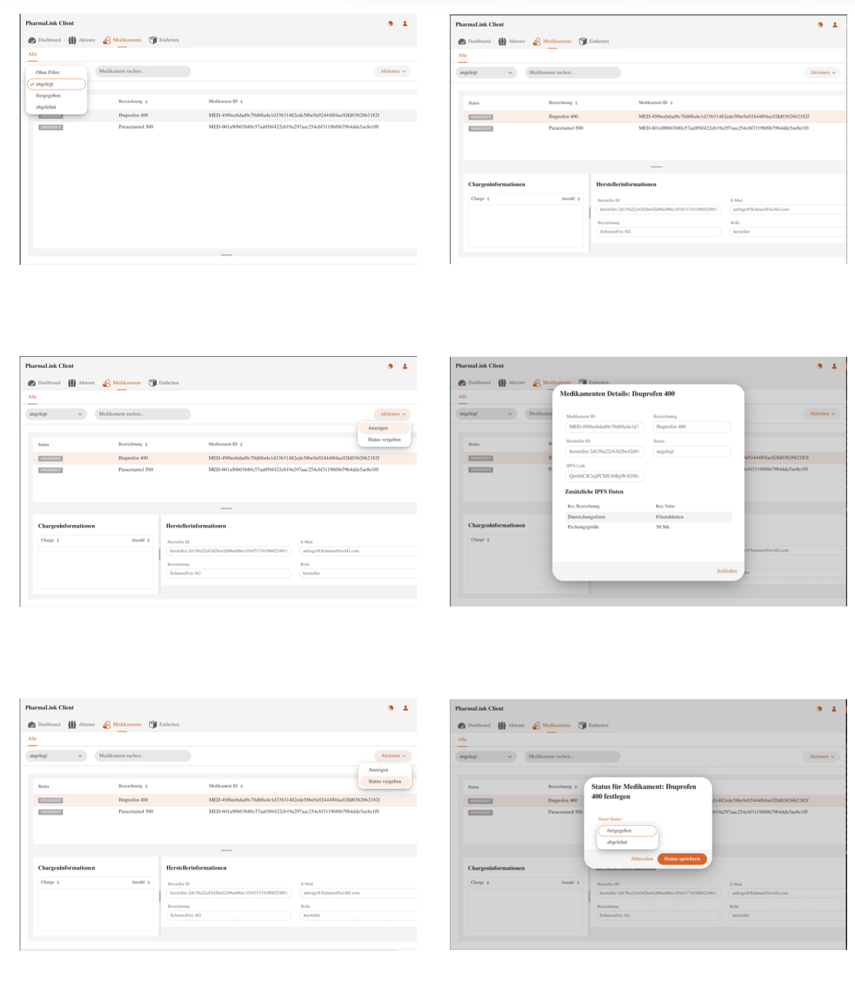

# System Architecture

PharmaLink combines a **permissioned Hyperledger Fabric ledger** (authoritative write model), **IPFS** (immutable off-chain document payloads), and **MongoDB** (event-driven CQRS read model, cache, and 4-layer audit store) behind a **Spring Boot 3.5** backend and a **Vaadin 24** client UI.

---

## 1. Container & Integration Topology



---

## 2. Federated & Local Network Diagrams

The target topology models national/regional supply-chain networks joined on a shared Fabric channel (`pharmalink`) defined in `common/configtx.yaml`.

### 2.1 Federated Multi-Country Channel (`1_network-overview_countries.png`)



Organizations (`Country A`, `Country B`, `Country C`) each operate peer nodes, anchor peers (`P1 = AP`, `P3 = AP`, `P4 = AP`) connected via gRPC Gossip, and their own Certificate Authority (`CA1`–`CA3`), sharing blocks from a multi-node Raft `Orderer Service` (`S1`–`S6`).

### 2.2 Country Node Inventory (`5_countries-detail.png`)



Each country domain manages local orderers, peer sets, enrolled client/device identities (`D1`–`D9`), and an organization CA issuing X.509 certificates carrying role affiliations.

### 2.3 Single-Country Application Stack (`2_country-architecture_local.png`)



Inside a country/organization boundary, the participant application (`Manufacturer`, `Wholesaler`, `Pharmacy`, or `Authority`) runs a Spring Boot `Backend` backed by `MongoDB`, connects to an `IPFS` peer, authenticates via its CA identity (`DC1`), submits gRPC transactions to the Fabric peer, and serves a `Frontend` over REST.

### 2.4 End-to-End Transaction Sequence (`4_transaction-sequence_med-create.png`)



1. The `Client Application` sends `POST /api/v1/medications` with product metadata and optional `ipfsData`.
2. `MedicationFabricService` serializes `ipfsData` via `IpfsClient.addObject()`, pinning JSON to IPFS and storing the returned CID in `pharmalink.ipfs_cache`.
3. `FabricClient.submitGenericTransaction()` endorses, orders, and commits `createMedikament` on the `pharmalink` channel.
4. `PharmaSupplyChainContract` persists the `Medikament` asset and `unitCounter_<medId>` in CouchDB, emits `MedikamentCreated`, and returns HTTP `201 Created`.

### 2.5 Client Workflow (`3_ui-medications.png`)



The Vaadin 24 `MedikamenteView` lets users filter medications (`No Filter`, `angelegt`, `freigegeben`, `abgelehnt`), inspect batch counts and manufacturer details, expand off-chain IPFS attributes (`Dosage Form`, `Package Size`), and submit regulatory approval decisions (`freigegeben` / `abgelehnt`).

---

## 3. Event-Driven CQRS Read-Model (`SystemStateService`)

Querying CouchDB across the network for every UI search adds latency. `SystemStateService` maintains a synchronized local projection in MongoDB:

1. **Startup Reconciliation (`@PostConstruct`):**
   - Loads `SystemState` (`id = "pharmalink-system-state"`) containing `currentActorId` and `lastProcessedBlockNumber`.
   - Calls `synchronizeWithChaincode()` to refresh `pharmalink.actors`, `pharmalink.medikamente`, and (once initialized) `currentActorId`'s units in `pharmalink.units`.
2. **Checkpoint-Resilient Event Stream (`startEventListening`):**
   - Subscribes to chaincode events starting at `lastProcessedBlock.get() + 1` via `FabricClient.startEventListeningWithRetry()`, reconnecting automatically on gRPC stream failures.
   - Logs every raw event to `audit.chaincode_events`, dispatches incremental updates to MongoDB repositories, and persists the new block checkpoint.

### Supported Chaincode Events (14)

| Event Name | Handler Action in `SystemStateService` |
| :--- | :--- |
| `ActorInitialized`, `ActorCreated`, `ActorUpdated`, `ActorIpfsLinkUpdated` | Fetch enriched `Actor` from ledger + IPFS and upsert into `pharmalink.actors` |
| `ActorDeleted` | Delete actor from `pharmalink.actors` |
| `MedikamentCreated`, `MedikamentStatusUpdated`, `MedikamentUpdated`, `MedikamentTagAdded` | Fetch enriched `Medikament` from ledger + IPFS and upsert into `pharmalink.medikamente` |
| `MedikamentDeleted` | Delete medication from `pharmalink.medikamente` |
| `UnitCreated` | Reconstruct batch unit entry from payload and save into `pharmalink.units` |
| `UnitTemperatureAdded` | Re-fetch enriched unit and update `pharmalink.units` |
| `UnitTransferred` | Re-sync unit inventories for both sender and recipient in `pharmalink.units` |
| `UnitDeleted` | Delete unit from `pharmalink.units` |

### MongoDB Collections & Views

| Collection / View | Purpose |
| :--- | :--- |
| `pharmalink.actors`, `pharmalink.medikamente`, `pharmalink.units` | CQRS read projections synced from chaincode |
| `pharmalink.ipfs_cache` | Positive cache of fetched/pinned IPFS documents with `createdAt` & `lastAccessed` |
| `pharmalink.state` | Singleton sync state (`currentActorId`, `lastProcessedBlockNumber`) |
| `auth.users`, `auth.roles` | Spring Security credentials and roles (`ADMIN`, `USER`) |
| `audit.api_transactions`, `audit.grpc_transactions`, `audit.chaincode_events`, `audit.login_attempts` | 4-layer observability & compliance audit log |
| `template.unit_deep_dive`, `template.stats_ipfs_usage` | MongoDB aggregation views created at startup by `NoSqlTemplateInitializer` |

---

## 4. Off-Chain Storage & Caching (`IpfsClient`)

Large or unstructured attributes (`ipfsData` maps on actors, medications, and units) stay off-chain to keep ledger block payloads compact:

- **Write path (`addObject`):** Serializes maps or strings to UTF-8 JSON, pins via `ipfs.add(...)`, receives the Base58 CID (`Qm...`), and writes immediately to `pharmalink.ipfs_cache`.
- **Read path (`getObject`):**
  1. Validates Base58 CID format (`isValidIpfsHashFormat`).
  2. Checks MongoDB positive cache (`IpfsCacheEntry`); updates `lastAccessed` on hit.
  3. Checks in-memory `failedHashesCache`; skips remote `ipfs.cat()` calls for 5 minutes after a failure to prevent blocking UI list hydration.
  4. On live fetch success, stores content in `pharmalink.ipfs_cache` for future reads.
- **Leaflet Integrity:** `Medikament.infoblattHash` stores the SHA-256 hash on-chain so downstream pharmacies or authorities can verify document integrity independently of IPFS availability.

---

## 5. Identity & Dual Security Architecture

### On-Chain Identity (Fabric X.509 `ecert`)

- `fabric_setup_test_consortium.sh` enrolls 3 users per role (`hersteller`, `grosshaendler`, `apotheke`, `behoerde`) with an embedded certificate attribute `role=<role>:ecert`.
- Inside `PharmaSupplyChainContract`, `initCall` and `getCallingActorFromContext()` parse the `role` attribute from `ClientIdentity` and derive the immutable on-chain actor ID:

  ```text
  actorId = <lowercase(role)> + "-" + sha256(mspId + "-" + clientId)
  ```

- Authorization cannot be spoofed via REST request bodies: the contract reads the signer's certificate identity directly from the Fabric execution context.

### Backend HTTP Security (`SecurityConfig`)

| FilterChain | Matcher | Mechanism | Session Policy |
| :--- | :--- | :--- | :--- |
| `apiSecurityFilterChain` (`@Order(1)`) | `/api/**` | `JwtRequestFilter` (HMAC-SHA JWT via `JwtUtil`) | `STATELESS` |
| `uiSecurityFilterChain` (`@Order(2)`) | `/app/**` and web assets | Form login (`/app/login` → `/authenticate`) | `JSESSIONID` HTTP session |

Passwords in `auth.users` use `BCryptPasswordEncoder`.

---

## 6. 4-Layer Audit Trail

1. **HTTP API Layer (`audit.api_transactions`):** `ApiTransactionInterceptor` (registered on `/api/v1/**`) records URL, HTTP method, authenticated username, cached request body (`RequestCachingFilter`), HTTP status, success flag, and error text.
2. **Fabric gRPC Layer (`audit.grpc_transactions`):** `FabricClient` logs every `submitTransaction` and `evaluateTransaction` call with serialized arguments, response payload, and exceptions.
3. **Ledger Event Layer (`audit.chaincode_events`):** `SystemStateService.logEventForAudit()` persists every `ChaincodeEvent` (`eventName`, `transactionId`, `blockNumber`, UTF-8 payload).
4. **Authentication Layer (`audit.login_attempts`):** `LoginAuditListener` captures Spring Security `AuthenticationSuccessEvent` and `AbstractAuthenticationFailureEvent` with client IP, User-Agent, and authentication class.

---

## 7. Dual UI Architecture

- **Primary Client UI (`frontend/` — Vaadin 24.8):** Multi-view application tailored to supply-chain workflows (`DashboardView` with ZXing QR codes, `ActorExplorerView`, `MedikamenteView`, `UnitsView` 3-level TreeGrid), communicating exclusively with the backend REST API via JWT.
- **Embedded Node Diagnostics UI (`src/main/resources/web/` — Thymeleaf):** Lightweight server-rendered interface on the backend itself (`/app/dashboard`) exposing raw JSON audit streams (`apiTransactionsJson`, `grpcTransactionsJson`, `loginAttemptsJson`), role-specific KPIs, and cached collections (`json-formatter-js`).

---

## 8. Prototype Scope vs Production-Hardening

| Area | Current Test-Platform State | Required for Production |
| :--- | :--- | :--- |
| **Secrets & Credentials** | Default `admin`/`admin123`, `user`/`user`, and dev Base64 JWT key | External secret manager / vault, strong per-node secrets, rotated JWT keys |
| **TLS & Network Boundaries** | Local test-network TLS certs (`override-auth: peer0.org1.example.com`) and HTTP localhost | Mutual TLS (`mTLS`) across services, strict CORS origin allowlists, reverse proxy TLS |
| **Chaincode Endorsement** | Single-channel test-network defaults (`Org1` + `Org2`) | Role-aligned endorsement policies across distinct independent MSP organizations |
| **Test Coverage** | Empty Spring context test stub; zero automated chaincode unit tests | JUnit/Mockito contract tests (targeting existing 90% JaCoCo threshold) + Testcontainers integration tests |
| **Data Projection** | `NoSqlTemplateInitializer` views join on mismatched field names; `UnitCreated` relies on sequential suffix parsing | Schema-aligned MongoDB views and idempotent single-unit upsert handlers |
