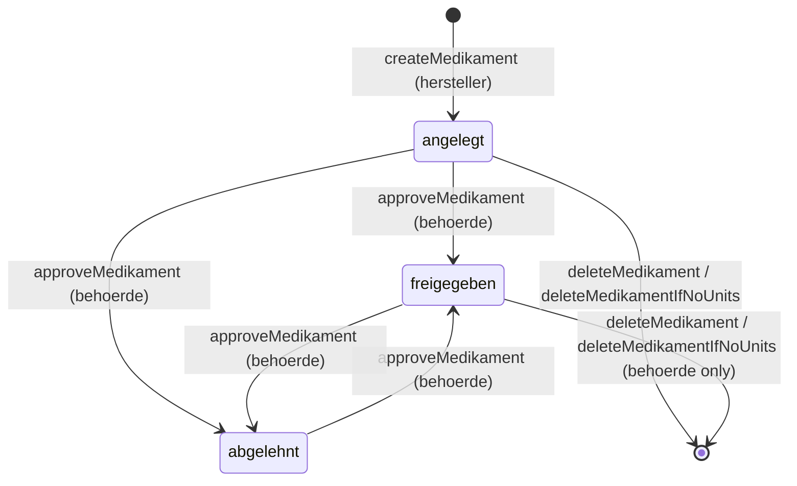
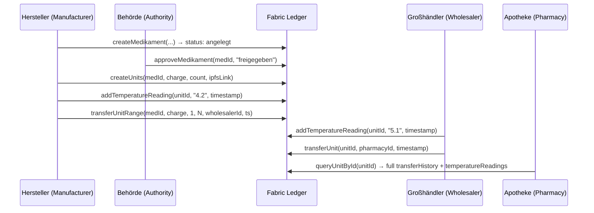

# Domain Model & On-Chain Business Logic

All authoritative state lives in Hyperledger Fabric's CouchDB-backed World State and is enforced by `PharmaSupplyChainContract` (`chaincode/pharmalink_chaincode_main`).

## 1. Ledger Entities

### `Actor` (`docType = "actor"`)

Represents a supply-chain participant derived from an X.509 certificate or created by a regulatory authority.

| Field | Type | Description |
| :--- | :--- | :--- |
| `actorId` | `String` | Primary ledger key: `<role>-<sha256(mspId + "-" + clientId)>` when initialized via `initCall` |
| `bezeichnung` | `String` | Organization or actor display name |
| `role` | `String` | Supply-chain role (`hersteller`, `grosshaendler`, `apotheke`, `behoerde`) |
| `email` | `String` | Contact e-mail address |
| `ipfsLink` | `String` | Optional IPFS CID pointing to extended JSON profile metadata |
| `docType` | `String` | Fixed CouchDB discriminator `"actor"` |

### `Medikament` (`docType = "medikament"`)

Represents a pharmaceutical product registered by a manufacturer and reviewed by a regulatory authority.

| Field | Type | Description |
| :--- | :--- | :--- |
| `medId` | `String` | Primary ledger key: `MED-<sha256(herstellerId + "-" + bezeichnung)>` |
| `herstellerId` | `String` | `actorId` of the creating manufacturer |
| `bezeichnung` | `String` | Product name (e.g. `Ibuprofen 400`) |
| `infoblattHash` | `String` | SHA-256 checksum of the patient information leaflet |
| `ipfsLink` | `String` | IPFS CID holding extended product attributes (dosage form, package size, etc.) |
| `status` | `String` | Lifecycle state: `angelegt` (initial), `freigegeben` (approved), or `abgelehnt` (rejected) |
| `approvedById` | `String` | `actorId` of the `behoerde` that approved or rejected the product |
| `tags` | `Map<String, String>` | Role-keyed annotations (`"hersteller"` and/or `"behoerde"`) |
| `docType` | `String` | Fixed CouchDB discriminator `"medikament"` |

### `Unit` (`docType = "unit"`)

Represents an individual serialized pharmaceutical package belonging to an approved medication batch (`Charge`).

| Field | Type | Description |
| :--- | :--- | :--- |
| `unitId` | `String` | Primary ledger key: `<medId>-<chargeBezeichnung>-<04d counter>` (serial per medication via `unitCounter_<medId>`) |
| `medId` | `String` | Parent `Medikament` ID |
| `chargeBezeichnung` | `String` | Batch identifier (e.g. `CH-2025-07`) |
| `ipfsLink` | `String` | Optional IPFS CID for batch/unit metadata |
| `currentOwnerActorId` | `String` | `actorId` of the current custodian |
| `transferHistory` | `List<TransferEntry>` | Ordered custody transfers (`fromActorId`, `toActorId`, `timestamp`) |
| `temperatureReadings` | `List<TemperatureReading>` | Ordered cold-chain measurements (`timestamp`, `temperature`) |
| `isConsumed` | `boolean` | Consumption flag (default `false`) |
| `consumedRefId` | `String` | External consumption reference (default `""`) |
| `docType` | `String` | Fixed CouchDB discriminator `"unit"` |

---

## 2. State Lifecycles

### Medication Approval State Machine

- Only medications in state `freigegeben` can mint serialized `Unit` batches via `createUnits`.
- Manufacturers may delete their own medication **only** while it remains in `angelegt`; authorities (`behoerde`) may delete medications in any status (or guarded by `deleteMedikamentIfNoUnits` when zero units exist).

### Unit Custody & Cold-Chain Flow

---

## 3. RBAC Permission Matrix

Authorization checks execute on-chain in `PharmaSupplyChainContract` against the caller's verified `Actor` record (`getCallingActorFromContext`):

| Transaction | `hersteller` | `behoerde` | `grosshaendler` | `apotheke` | Additional Constraints |
| :--- | :---: | :---: | :---: | :---: | :--- |
| `initCall` | ✅ | ✅ | ✅ | ✅ | Requires valid `role` X.509 attribute (`ecert`) |
| `createActor` | ❌ | ✅ | ❌ | ❌ | Rejects duplicate `actorId` |
| `updateActor` | Own only | ✅ (any) | Own only | Own only | Caller must equal `actorId` or hold `behoerde` |
| `updateActorIpfsLink` | Own only | Own only | Own only | Own only | Strictly owner-only |
| `deleteActor` | ❌ | ✅ | ❌ | ❌ | — |
| `createMedikament` | ✅ | ❌ | ❌ | ❌ | Deterministic `medId`; creates `unitCounter_<medId>` |
| `approveMedikament` | ❌ | ✅ | ❌ | ❌ | Target status must be `freigegeben` or `abgelehnt` |
| `updateMedikament` | Own only | ❌ | ❌ | ❌ | Strictly creating manufacturer (`herstellerId`) |
| `addMedikamentTag` | Own only | ✅ (any) | ❌ | ❌ | Writes under `"hersteller"` or `"behoerde"` map key |
| `deleteMedikament` / `deleteMedikamentIfNoUnits` | Own (`angelegt` only) | ✅ (any) | ❌ | ❌ | Conditional variant aborts if units > 0 |
| `createUnits` | Own only | ❌ | ❌ | ❌ | Medication must be `freigegeben` |
| `addTemperatureReading` | Owner only | Owner only | Owner only | Owner only | Caller must equal `currentOwnerActorId` |
| `transferUnit` / `transferUnitRange` | Owner only | Owner only | Owner only | Owner only | Caller must own unit(s); recipient must exist |
| `deleteUnits` | Owner only | Owner only | Owner only | Owner only | Atomic pre-check across all unit IDs |
| All `query*` read functions | ✅ | ✅ | ✅ | ✅ | Channel read access for any enrolled member |

---

## 4. Chaincode Error Codes (`PharmaSupplyChainErrors`)

| Error Code | Trigger Condition |
| :--- | :--- |
| `ACTOR_NOT_FOUND` | Actor ID missing in ledger (including caller before `initCall` or unknown transfer recipient) |
| `ACTOR_ALREADY_EXISTS` | `createActor` called with an existing `actorId` |
| `INVALID_ARGUMENT` | Unknown `role` affiliation, invalid `transferUnitRange` bounds, or empty `deleteUnits` array |
| `UNAUTHORIZED_ACCESS` | Caller lacks required role or ownership of target actor/medication/unit |
| `MISSING_CERT_ATTRIBUTE` | Caller X.509 certificate lacks the `role` attribute |
| `MEDIKAMENT_NOT_FOUND` | Medication ID does not exist in World State |
| `MEDIKAMENT_ALREADY_EXISTS` | Duplicate `(herstellerId, bezeichnung)` medication hash |
| `INVALID_MEDIKAMENT_STATUS_CHANGE` | Status passed to `approveMedikament` is neither `freigegeben` nor `abgelehnt` |
| `UNIT_NOT_FOUND` | Requested `unitId` (or serial in range) does not exist |
| `UNIT_ALREADY_EXISTS` | Serial counter collision on `createUnits` |
| `MEDIKAMENT_NOT_APPROVED` | `createUnits` invoked while medication status is not `freigegeben` |
| `INVALID_UNIT_OWNER` | Batch transfer/delete includes a unit not owned by caller |
| `MEDIKAMENT_HAS_UNITS` | `deleteMedikamentIfNoUnits` rejected because one or more units exist |
